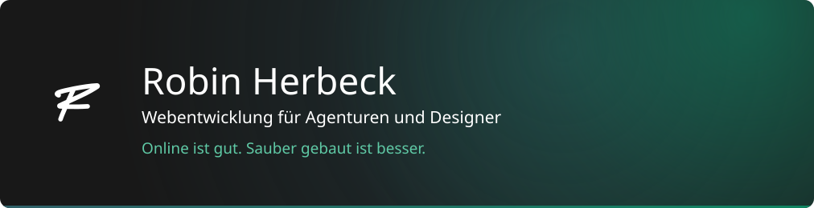
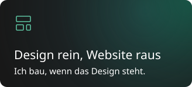
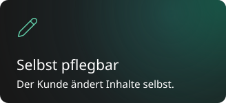
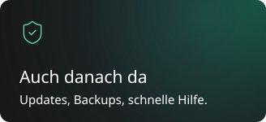

  
  
  

Ich bin Robin. Ich bau die Websites, wenn das Design steht, und kümmer mich auch danach drum. Der Kunde bleibt bei dir.

Meistens gestaltet ein Designer oder eine kleine Agentur, und ich mach daraus eine Website, die der Kunde danach selbst pflegen kann. Wenn was hakt, bin ich da.

Hier auf GitHub liegen vor allem die WordPress-Plugins, die ich in meinen Projekten immer wieder brauche.

Lust auf nen Kaffee oder ein kurzes Telefonat? Schreib mir einfach.

  
  
  

Technik: WordPress mit Block-Themes, Next.js, TypeScript, PHP, selbst gehostet in der EU.
